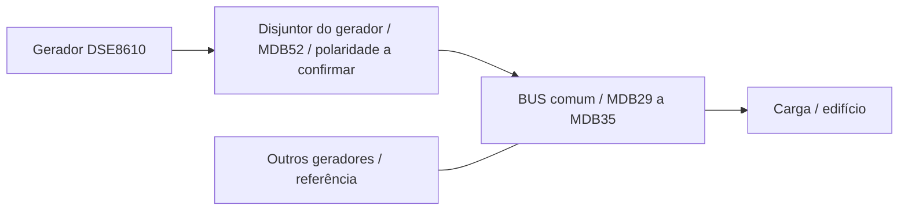

# DSE8610 / análise do BIN LOGSIS

Foram extraídos **100 slots MDB**, dos quais **52 estão configurados** e **48 não configurados**. O arquivo tem 20685 bytes e 1425 chaves sem duplicações. A extensão é BIN, mas o conteúdo deste arquivo é ASCII no formato `chave;valor`.

SHA-256: `2eabb9f40a6e8300ed2d19c6b5b6cc893151cda20ef295c88ea70ce3a880525d`.

Esta análise comprova o que está configurado no arquivo, sem ler o controlador ou o banco de produção. O modelo DSE8610 foi informado pelo usuário; a variante e o firmware não estão confirmados. A correspondência índice zero → MDB01/mdb1 segue a convenção LOGSIS da planta anterior e deve ser conferida na ingestão. Os endereços abaixo são os números armazenados no BIN, sem deslocar base ou acrescentar prefixo 4xxxx.

## Resultado para a nova planta

| Função | Posições |
|---|---|
| Motor e combustível | MDB01–MDB07 |
| Frequência do gerador | MDB08 |
| Tensões do gerador, fase-neutro e fase-fase | MDB09–MDB14 |
| Correntes do gerador e terra | MDB15–MDB18 |
| Potências do gerador | MDB19–MDB24 |
| Fatores de potência do gerador | MDB25–MDB28 |
| Frequência do BUS comum | MDB29 |
| Tensões do BUS, fase-neutro e fase-fase | MDB30–MDB35 |
| Horímetro, energia e partidas | MDB36–MDB38 |
| Horas de manutenção | MDB39 |
| Modo de operação | **MDB40**, endereço 772 |
| Warning / trip elétrico / shutdown | **MDB41 / MDB42 / MDB43**, endereço 774, BIT 10 / 11 / 12 |
| Entradas A–H | **MDB44–MDB51** |
| Sinal rotulado disjuntor do barramento | **MDB52**, endereço 48659 |
| Sem configuração | **MDB53–MDB100** |

O BUS existe como medição própria. Não há necessidade de representá-lo como concessionária. O total ativo MDB22 pertence ao gerador monitorado: não comprova a potência total dos outros grupos nem a potência total consumida pela carga comum.

## Diferenças que impedem copiar o mapeamento do DSE7420

- MDB29–MDB35 deixam de representar rede e passam a representar **BUS**, com endereços 1091 e 1092/1094/1096/1098/1100/1102.
- O modo muda de MDB43 para **MDB40**. Reutilizar MDB43 como modo faria a planta interpretar **shutdown como modo de operação**.
- Neste BIN há somente MDB39 identificado como horas de manutenção. MDB40–MDB42 não são três contadores adicionais de manutenção.
- Alarmes e entradas mudam de posição: warning/trip/shutdown em MDB41–MDB43; entradas A–H em MDB44–MDB51.
- MDB52 não é a antiga entrada F: é o sinal denominado disjuntor do barramento.
- MDB55/MDB56 continuam sem configuração e não podem ser usados como os dois contatos da antiga chave de transferência.

## Modo: rótulos e limiares encontrados

No índice 39 (MDB40) constam `DM=AUTOMATICO`, `DH=MANUAL`, `DL=STOP`, `TH=1`, `TL=1`, `BIT=-1`, `FNC=3`, endereço 772.

Essa organização é compatível com **0=STOP, 1=AUTO, 2=MANUAL**, caso o coletor use as comparações usuais abaixo/igual/acima de 1. É uma **hipótese baseada nos rótulos e limiares**, não uma tabela de enumeração explicitamente declarada no arquivo. Não copiar automaticamente o mapeamento legado 0=STOP/1=MANUAL/2=AUTO da planta DSE7420. Conferir um valor bruto em cada modo ou a documentação da variante do controlador.

## Disjuntor e paralelismo

MDB52 contém `DM=DISJUNTOR DO BARRAMENTO INATIVA`, `DH=DISJUNTOR DO BARRAMENTO ATIVA`, `TH=0`, `TL=0`, `BIT=-1`, `FNC=3`, endereço 48659.

O arquivo **não declara** que esse campo seja um contato auxiliar de posição, que 0 signifique aberto ou que 1 signifique fechado. O nome no BIN, isoladamente, não distingue esses papéis nem separa comando de retorno de posição. O usuário confirmou que o equipamento associado a MDB52 é **o disjuntor que acopla este gerador ao BUS**. Essa confirmação identifica sua função na planta; os valores de aberto/fechado e a natureza do sinal ainda precisam ser conferidos antes de animar o contato.

Não foram encontrados canais explicitamente rotulados como sincronismo, ângulo de fase, autorização de fechamento, quantidade de grupos em paralelo ou potência agregada do BUS. A existência de tensões nas duas fontes não comprova sincronismo nem paralelismo. Os demais geradores podem ser desenhados como referência ao sistema compartilhado, sem inventar quantidade ou estados individuais.

## Comunicação e decodificação

- Identificador `ID=10` nos 52 canais configurados; `MDB_BAUD=19200`; `MDB_TOUT=10`; `MDB_R_DELAY=600`. A unidade dos dois últimos parâmetros não é declarada neste arquivo. Paridade e bits de parada não foram identificados por esses campos.
- 26 canais com código `FNC=3` e 26 com `FNC=30`. O código 30 é armazenado pelo configurador; **não presumir que seja uma função Modbus padrão enviada no fio**. O avanço de dois endereços em tensões/correntes é um indício de leitura em pares de registradores, cuja largura, ordem de palavras e sinal dependem do coletor/protocolo.
- `BIT=10/11/12` está configurado nos três alarmes do endereço 774. Verificar se o coletor já entrega o bit extraído em cada coluna para não aplicar uma segunda extração no dashboard.
- `H`, `VR`, `SM`, `TH` e `TL` foram preservados como parâmetros brutos na planilha. **H=100 ou H=1000 não comprova divisor de escala**. Tampouco os limiares de alarme comprovam o tipo, o valor de indisponibilidade ou a unidade de engenharia.
- Não transpor indiscriminadamente o corte de 32760 para campos que possam ser de 32 bits. Confirmar escalas de tensão, corrente, potências, energia e tempo comparando dados brutos com o controlador. O BIN sozinho não confirma os divisores SQL.

## Composição proposta para o desenho

O desenho não terá concessionária nem chave de transferência entre rede e gerador. As leituras do GMG ficam associadas ao seu desenho; as leituras MDB29–MDB35 ficam associadas ao BUS. O padrão visual e o comportamento responsivo da V32 podem ser mantidos em um único JSON para a nova planta. O dashboard DSE8610 deverá ter UID e tabela `Id_Logsis` próprios, preservando a planta DSE7420 já aprovada; não haverá dashboards distintos para celular e computador.

A cor do BUS deve decorrer de suas próprias medições, após validar escalas e indisponibilidade. Ele pode estar energizado pelos outros grupos com o disjuntor deste gerador aberto. O desenho não deve apagar o BUS apenas porque este gerador parou, nem indicar corrente/direção de potência somente por haver tensão. Sem retorno de posição validado, o disjuntor deve permanecer como posição desconhecida. Ausência de dado não equivale a zero.

## Mapeamento completo dos canais configurados

`FNC` e `BIT` abaixo são os valores literais do arquivo.

| Posição esperada | Rótulo configurado | Endereço decimal | FNC | BIT |
|---|---|---:|---:|---:|
| MDB01 | PRESSAO OLEO | 1024 | 3 | -1 |
| MDB02 | TEMP MOTOR | 1025 | 3 | -1 |
| MDB03 | TEMP OLEO | 1026 | 3 | -1 |
| MDB04 | COMBUSTIVEL | 1027 | 3 | -1 |
| MDB05 | ALT CARGA | 1028 | 3 | -1 |
| MDB06 | BATERIA OK | 1029 | 3 | -1 |
| MDB07 | RPM | 1030 | 3 | -1 |
| MDB08 | FREQ GMG | 1031 | 3 | -1 |
| MDB09 | TENSAO GMG L1N | 1032 | 30 | -1 |
| MDB10 | TENSAO GMG L2N | 1034 | 30 | -1 |
| MDB11 | TENSAO GMG L3N | 1036 | 30 | -1 |
| MDB12 | TENSAO GMG L1-L2 | 1038 | 30 | -1 |
| MDB13 | TENSAO GMG L2-L3 | 1040 | 30 | -1 |
| MDB14 | TENSAO GMG L3-L1 | 1042 | 30 | -1 |
| MDB15 | CORRENTE GMG L1 | 1044 | 30 | -1 |
| MDB16 | CORRENTE GMG L2 | 1046 | 30 | -1 |
| MDB17 | CORRENTE GMG L3 | 1048 | 30 | -1 |
| MDB18 | CORRENTE TERRA GMG | 1050 | 30 | -1 |
| MDB19 | POTENCIA GMG L1 | 1052 | 30 | -1 |
| MDB20 | POTENCIA GMG L2 | 1054 | 30 | -1 |
| MDB21 | POTENCIA GMG L3 | 1056 | 30 | -1 |
| MDB22 | POTENCIA TOTAL GMG | 1536 | 30 | -1 |
| MDB23 | VA TOTAL GMG | 1544 | 30 | -1 |
| MDB24 | VAR TOTAL GMG | 1552 | 30 | -1 |
| MDB25 | FP GMG L1 | 1554 | 3 | -1 |
| MDB26 | FP GMG L2 | 1555 | 3 | -1 |
| MDB27 | FP GMG L3 | 1556 | 3 | -1 |
| MDB28 | FP MEDIO GMG | 1557 | 3 | -1 |
| MDB29 | FREQ BUS | 1091 | 3 | -1 |
| MDB30 | TENSAO BUS L1N | 1092 | 30 | -1 |
| MDB31 | TENSAO BUS L2N | 1094 | 30 | -1 |
| MDB32 | TENSAO BUS L3N | 1096 | 30 | -1 |
| MDB33 | TENSAO BUS L1-L2 | 1098 | 30 | -1 |
| MDB34 | TENSAO BUS L2-L3 | 1100 | 30 | -1 |
| MDB35 | TENSAO BUS L3-L1 | 1102 | 30 | -1 |
| MDB36 | HORIMETRO | 1798 | 30 | -1 |
| MDB37 | KWH GERADOR | 1800 | 30 | -1 |
| MDB38 | NUMERO PARTIDAS | 1808 | 30 | -1 |
| MDB39 | HORAS MANUTENCAO | 1794 | 30 | -1 |
| MDB40 | AUTOMATICO | 772 | 3 | -1 |
| MDB41 | SEM WARNING | 774 | 3 | 10 |
| MDB42 | SEM TRIP ELETRICO | 774 | 3 | 11 |
| MDB43 | SEM SHUTDOWN | 774 | 3 | 12 |
| MDB44 | ENTRADA A OFF | 43521 | 3 | -1 |
| MDB45 | ENTRADA B OFF | 43523 | 3 | -1 |
| MDB46 | ENTRADA C OFF | 43525 | 3 | -1 |
| MDB47 | ENTRADA D OFF | 43527 | 3 | -1 |
| MDB48 | ENTRADA E OFF | 43529 | 3 | -1 |
| MDB49 | ENTRADA F OFF | 43531 | 3 | -1 |
| MDB50 | ENTRADA G OFF | 43533 | 3 | -1 |
| MDB51 | ENTRADA H OFF | 43535 | 3 | -1 |
| MDB52 | DISJUNTOR DO BARRAMENTO INATIVA | 48659 | 3 | -1 |

Os 48 slots MDB53–MDB100 têm ID, função e endereço iguais a −1 e rótulo principal vazio. A planilha e o JSON incluem também esses slots para rastreabilidade. Nenhum slot com configuração parcial foi encontrado.

## Para fechar a vinculação da planta

1. Confirmar a variante DSE8610 e o que o coletor entrega em `mdb1`…`mdb52`: tipos, ordem de palavras, escalas e eventual extração de bits.
2. Comparar MDB40 com STOP/AUTO/MANUAL no controlador.
3. A função do equipamento MDB52 já foi confirmada pelo usuário: acoplamento deste gerador ao BUS. Falta observar os valores de aberto/fechado e confirmar a natureza do sinal.
4. Se a tela precisar afirmar “sincronizado” ou “em paralelo”, identificar os registros específicos; este BIN não os nomeia.

O pacote contém apenas a análise de mapeamento, não um dashboard importável. As configurações não relacionadas aos MDBs não foram incluídas nos arquivos de saída.
