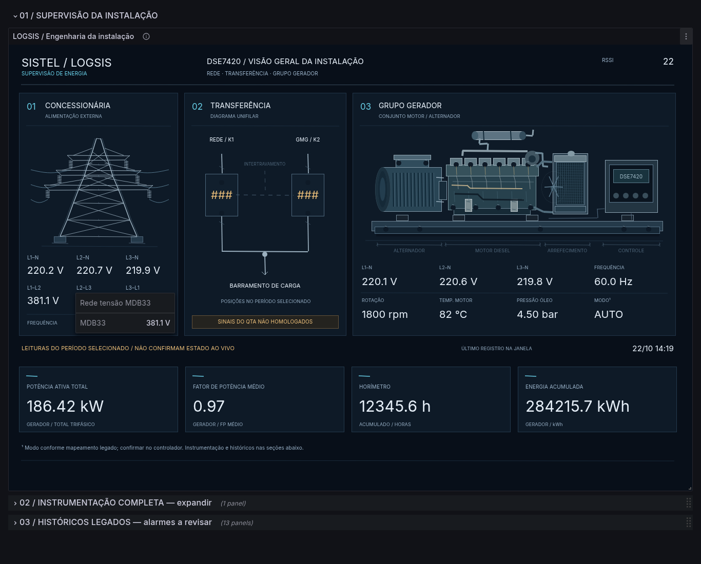

# LOGSIS / DSE7420 — V24 Engineering

## Instalar

Baixe `V24_IMPORTAR.zip`, extraia e selecione `V24_IMPORTAR.json` em **Dashboards → New → Import → Upload dashboard JSON file**. Não envie o ZIP nem cole o link do GitHub no campo de IDs do catálogo Grafana.com.

A V24 usa UID próprio (`logsis-dse7420-v24-engineering`), permitindo comparar com a V23 sem substituí-la. Mantém o datasource PostgreSQL de UID `zKW_ld27k` e a constante `Id_Logsis` herdados da V23.

## O que mudou no desenho

- A torre usa perfis metálicos, treliças, travessas, cadeias de isoladores, fundações e curvas de cabos.
- O grupo gerador ocupa uma área maior e apresenta alternador cilíndrico, carcaça ventilada, bloco, cabeçote, tampas, injetores, filtros, coletores, turbo, escape, radiador, ventilador, controlador, coxins e skid.
- O QTA usa traços de diagrama elétrico, bornes, contornos de disjuntores e indicação do vínculo mecânico. O estado continua vindo dos campos existentes, sem simular energização ou comandos.
- A planta utiliza 361 conexões vetoriais nativas, com espessuras de aproximadamente 0,5 a 4 pixels. Isso evita o limite mínimo de 10 pixels dos retângulos Canvas que deixava o desenho anterior grosseiro.
- Não há imagens externas, Base64, plugins adicionais ou HTML personalizado. As formas e conexões continuam editáveis no Canvas.
- Os desenhos são representações técnicas genéricas para supervisão, sem pretensão de reproduzir as dimensões de um modelo específico de motor ou alternador.

## O que foi preservado

Consultas SQL, datasource, escalas, unidades, mapeamentos, os 56 canais individuais e os 13 painéis históricos permanecem iguais aos da V23. A apresentação dos contatos do QTA conserva o mapeamento de caracteres; não é uma animação física homologada.

Permanecem as pendências técnicas da V23: sinais MDB55/MDB56 do QTA não homologados e vínculos históricos legados de alarmes a revisar. O redesign não valida sinais ou equipamentos reais. Não foram adicionados comandos de escrita.

## Evidências

`V24_PREVIEW.png` é uma captura do Grafana 11.2.2 com dados exclusivamente simulados.

`V24_VALIDACAO.json` registra verificações de integridade das consultas e históricos, nomes e destinos das conexões, limites do desenho, upload do arquivo pela interface web, leituras renderizadas e expansão dos 56 canais em 1366, 1440 e 1920 pixels. Também foi testado um intervalo sem dados, sem reutilizar leitura antiga. Não foram observados erros de consulta ou de JavaScript nesses testes.

A largura de referência do desenho continua sendo 1321 pixels; em telas largas pode sobrar espaço à direita. O teste desktop usa modo kiosk e zoom de 100%. Não há layout móvel homologado.

## Reproduzir o JSON

Na raiz deste repositório, execute `python tools/build_v24.py`. O script lê `LOGSIS_V23.json` sem modificá-lo e gera os arquivos de importação em `dist/`. Ele usa apenas a biblioteca padrão do Python e verifica a preservação das consultas, da instrumentação e dos históricos. Os arquivos V23 permanecem disponíveis para comparação.
