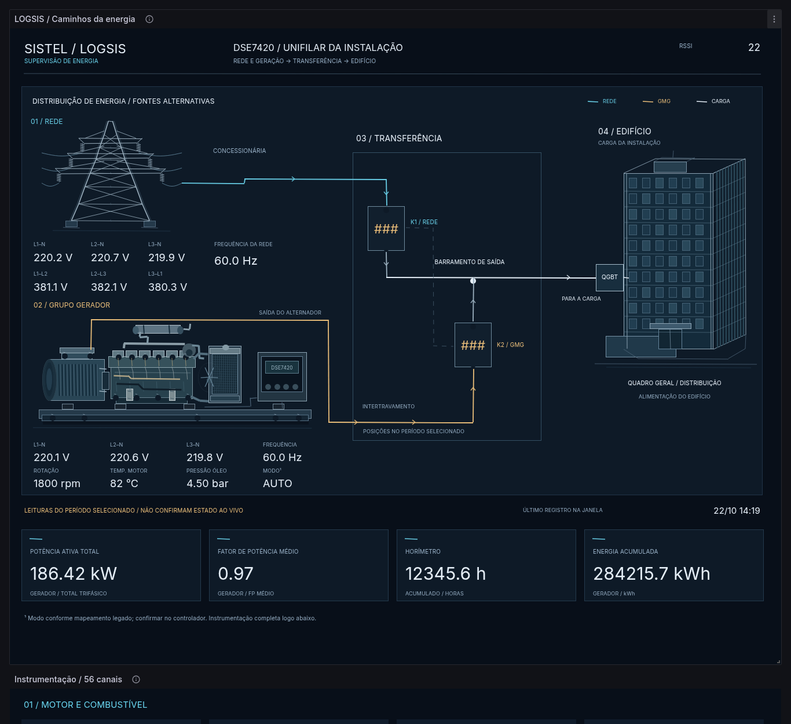

# LOGSIS / DSE7420 — V25 Unifilar

## Importação

Baixe `V25_IMPORTAR.zip`, extraia e selecione **V25_IMPORTAR.json** em **Dashboards → New → Import → Upload dashboard JSON file**.

A V25 tem UID próprio (`logsis-dse7420-v25-unifilar`), permitindo comparar com a V24. Datasource PostgreSQL, tabela, consultas e escalas continuam os mesmos da versão anterior.

## Uma única prancha

A torre, o grupo gerador, os contatos de transferência e o edifício compartilham uma mesma área de desenho. Não há três quadros independentes.

- **Rede:** torre, leituras da concessionária e percurso ciano até K1.
- **Gerador:** conjunto mecânico, leituras do GMG e saída do alternador em âmbar até K2.
- **Transferência:** entradas distintas pelos contatos K1/K2, vínculo mecânico tracejado e convergência no barramento de saída.
- **Carga:** percurso claro até o QGBT e o prédio, desenhado com fachada, pavimentos, perspectiva lateral, cobertura e acesso.

As cores e setas identificam a topologia e o sentido previsto de alimentação. Não confirmam que um circuito está energizado no instante atual. As posições dos contatos continuam vinculadas aos campos MDB55/MDB56 e ao período selecionado, com o mesmo tratamento de ausência/invalidez da V24. Não foram acrescentadas medições fictícias de consumo do edifício: a potência total em destaque continua sendo a do gerador, MDB22.

O desenho é composto por elementos e conexões nativos do Canvas. Não depende de imagens externas, SVG/Base64, plugins adicionais ou HTML personalizado.

## Preservado

A instrumentação com os 56 canais permanece aberta logo abaixo da planta. Apenas os históricos e alertas ficam em seção recolhível. Os textos de não homologação não foram reintroduzidos na tela.

Consultas SQL, unidades, escalas e mapeamentos são os da V24. Os 13 painéis históricos permanecem iguais, exceto pela posição vertical necessária ao novo desenho. A revisão visual não altera a configuração física ou a validação dos sinais da instalação.

## Validação e reprodução

`V25_PREVIEW.png` é uma renderização do Grafana 11.2.2 com dados exclusivamente simulados.

`V25_VALIDACAO.json` registra as verificações de preservação das consultas, instrumentação e históricos, resolução das conexões vetoriais, limites do desenho, upload pela interface web, leituras renderizadas e 56 canais disponíveis em três larguras desktop: 1366, 1440 e 1920 pixels. Também foi conferido um período sem dados, sem reutilização de leituras antigas.

A prancha tem largura de referência de 1321 pixels. Como na V24, em telas largas pode haver área livre à direita. As capturas usam modo kiosk e zoom de 100%.

Para reproduzir o arquivo, execute `python tools/build_v25.py` na raiz do repositório. O gerador usa `V24_IMPORTAR.json` como base e grava JSON e ZIP em `dist/`. Não modifica os arquivos das versões anteriores.
