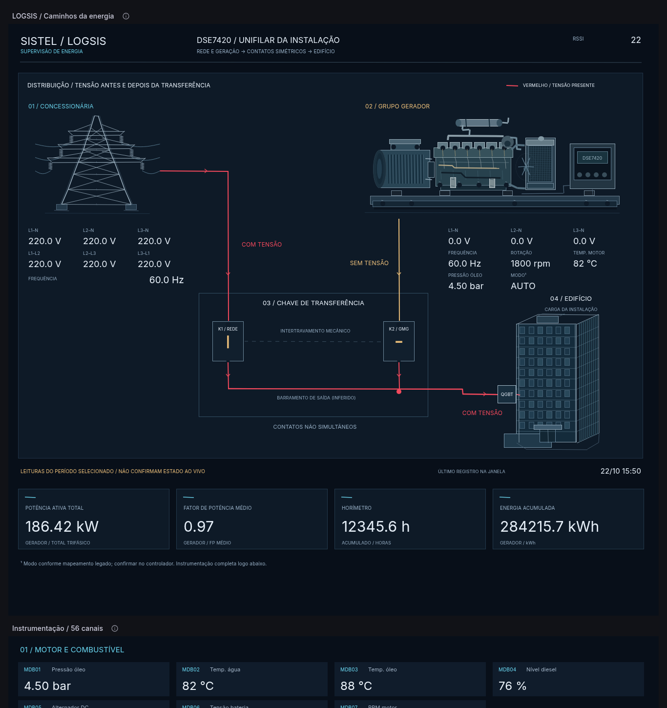

# LOGSIS / DSE7420 — V26 Unifilar

## Importar

Baixe `V26_IMPORTAR.zip`, extraia e use **Upload dashboard JSON file** para selecionar `V26_IMPORTAR.json` no Grafana. O dashboard tem UID próprio, `logsis-dse7420-v26-unifilar`, para comparar com as versões anteriores.

## Contatos e percursos

K1 (rede) e K2 (gerador) ficam lado a lado, com a mesma altura, largura, alinhamento e distância ao centro do QTA. Os dois recebem alimentação por cima e convergem no barramento inferior. O barramento alimenta o QGBT do edifício.

- **Antes de K1:** vermelho se houver tensão válida maior que zero em qualquer uma das seis tensões da rede (MDB30–35). Sem tensão, mantém o ciano original.
- **Antes de K2:** vermelho se houver tensão válida maior que zero em qualquer uma das seis tensões do gerador (MDB09–14). Sem tensão, mantém o âmbar original.
- **Depois dos contatos:** as duas derivações de saída e o barramento comum ficam vermelhos quando uma fonte com tensão está conectada por seu contato fechado. Sem alimentação pelas fontes conhecidas, mantêm a cor clara original.
- **Dados ausentes ou inválidos:** ficam na cor original e mostram `SEM DADOS` quando o estado não puder ser determinado. Ausência não é convertida automaticamente em zero.

Os trechos inferiores dos dois contatos pertencem ao mesmo barramento. Por isso, se K2 alimenta a saída e K1 está aberto, o trecho **depois** de K1 também fica vermelho: está ligado ao barramento alimentado por K2. O trecho **antes** de K1 depende da medição da rede.

As setas representam o sentido previsto de alimentação. A cor vermelha indica presença de tensão, não medição de corrente ou sentido real de fluxo de potência.

Com ambas as fontes presentes e ambos os contatos abertos, somente os trechos de entrada ficam vermelhos; a saída mantém a cor original. Com K1/K2 simultaneamente fechados, há indicação `VERIFICAR PARALELISMO`.

## Medição e inferência

O mapeamento fornecido não contém uma medição independente da tensão do barramento de saída. A indicação depois dos contatos é **inferida**, usando as tensões das fontes e os estados K1/MDB55 e K2/MDB56. A própria tela identifica a saída como inferida. Não é apresentada como leitura direta de um sensor de barramento.

O modelo considera as duas fontes desenhadas no unifilar. Para indicar a tensão real da saída com outras fontes ou retornos não representados, é necessário fornecer o campo de medição direta correspondente.

As cores são calculadas a partir de uma única amostra: a linha mais recente dentro do intervalo selecionado no Grafana. Se essa linha contiver sinais ausentes, o cálculo não recua para contatos ou tensões de registros anteriores. Valores brutos negativos ou maiores/iguais a 32760 não confirmam tensão. A presença em uma fase é suficiente para indicar tensão; ausência só é afirmada na fonte quando todas as seis tensões são zero.

O limiar de presença é estritamente maior que zero, conforme solicitado, sem presumir tensão nominal de 127/220/380 V.

Os indicadores numéricos originais conservam a regra da V23/V24/V25: último valor válido de cada campo dentro do período. Assim, podem mostrar um registro anterior enquanto o cálculo de cor informa `SEM DADOS` para a amostra mais recente. A leitura de um período histórico também não confirma estado atual da instalação.

## Preservado

As escalas, unidades e as expressões SQL dos 56 indicadores existentes foram preservadas. A consulta principal ganhou campos auxiliares para as cores e para a indicação de contatos simultâneos. A instrumentação completa permanece aberta abaixo da planta; os 13 painéis históricos e de alertas continuam na seção recolhível, com suas consultas originais.

A configuração da coleta e os sinais físicos não foram alterados. Não há comandos de escrita. Os testes descritos abaixo são realizados exclusivamente no laboratório sintético.

## Evidências

- `V26_SQL_VALIDACAO.json`: 81 combinações de fontes/contatos incluindo estados desconhecidos, mais quatro casos de janela vazia, leitura inválida, falta de dados no registro mais recente e tensão positiva em apenas uma fase.
- `V26_VISUAL_VALIDACAO.json`: verificação das cores efetivamente renderizadas nas linhas SVG antes e depois dos contatos, em sete cenários; importação pela interface web e conferência em 1366, 1440 e 1920 pixels.
- `V26_PREVIEW.png`: exemplo simulado com a rede alimentando a carga, gerador sem tensão e K1 fechado/K2 aberto.
- `V26_CONTATOS_ABERTOS.png`: fontes com tensão e contatos abertos, para comparar a entrada vermelha com a saída na cor original.
- `V26_SEM_DADOS.png`: tratamento visual de dados ausentes.

As imagens são capturas reais do Grafana 11.2.2 com amostras simuladas. A prancha tem largura de referência de 1321 pixels; testes desktop em modo kiosk, zoom 100%.

## Reproduzir

Na raiz do repositório, execute `python tools/build_v26.py`. O gerador usa `V25_IMPORTAR.json` como base de dados/configuração e `V24_IMPORTAR.json` como base da geometria aprovada. Gera JSON e ZIP em `dist/`, sem alterar as versões anteriores.

`python tools/validate_v26_sql.py` executa as verificações SQL somente no contêiner de laboratório `logsis-postgres`, com tabela temporária e rollback. Não aponta para banco de produção.
