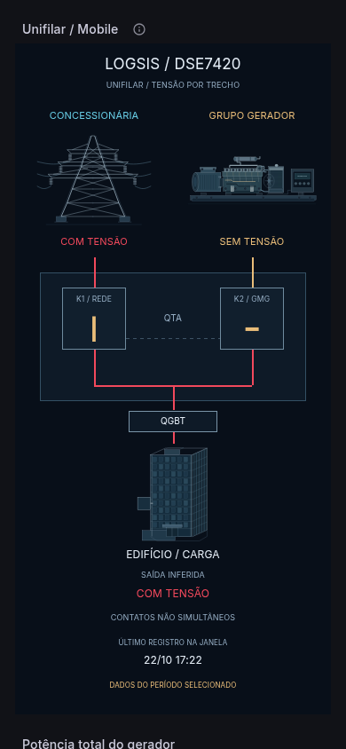

# LOGSIS / DSE7420 — V27 Mobile

## Instalar e abrir no celular

1. Baixe `V27_MOBILE_IMPORTAR.zip` e extraia o arquivo `V27_MOBILE_IMPORTAR.json`.
2. No Grafana, use **Dashboards → New → Import → Upload dashboard JSON file**.
3. Abra **LOGSIS / DSE7420 — V27 Mobile** no smartphone. O desenho se ajusta à largura disponível, sem zoom manual.

Esta é uma **visão Mobile separada da V26 desktop**. O Grafana 11.2.2 não oferece, no JSON do Canvas, troca de composição por breakpoint ou redirecionamento automático por tipo de aparelho. A V26 original continua disponível. A V27 tem um link **Visão desktop**, que preserva a seleção de período e variáveis ao navegar para a V26.

O ZIP opcional `V26_ATALHO_MOBILE.zip` contém `V26_DESKTOP_COM_ATALHO_MOBILE.json`, uma cópia da V26 com um link **Visão Mobile**. Ele pode ser importado para substituir a V26 caso você queira esse atalho. Se personalizou a V26 no seu Grafana, acrescente o link manualmente em Dashboard settings → Links para preservar suas edições: `/d/logsis-dse7420-v27-mobile/`.

## Ajustes para smartphone

- Unifilar compacto com posições horizontais em porcentagem e tipografia de tamanho legível.
- Torre, gerador e prédio como vetores incorporados ao próprio JSON. Não há arquivos de imagem externos nem links de imagem que dependam do GitHub.
- Traços elétricos se redimensionam pelo layout do navegador. Não dependem do recálculo de coordenadas das conexões Canvas, que pode atrasar no Grafana 11.2 após uma mudança de largura.
- Potência, FP, horímetro e energia em painéis **Stat nativos**, com adaptação de tipografia e disposição fornecida pelo Grafana.
- Os **56 canais** ficam em uma tabela aberta de duas colunas, com unidades explícitas e rótulos curtos identificados pelo número MDB, para evitar quatro colunas de cartões comprimidas na tela estreita.
- Históricos e alertas continuam em uma seção recolhível, com os 13 painéis e consultas preservados.
- Horário do último registro, indicação do período selecionado e diagnóstico dos contatos continuam visíveis.

A adaptação é de largura. Há rolagem vertical para consultar os indicadores, os 56 canais e os históricos; não há tentativa de comprimir todo o dashboard numa única tela de celular.

## Mesma lógica elétrica da V26

O SQL que determina tensões e contatos é o da V26, incluído integralmente. A consulta da visão Mobile acrescenta somente quatro campos de imagem dos traços, escolhendo entre vermelho e a cor original com base nos estados já calculados.

Antes dos contatos, vermelho significa presença de tensão na fonte correspondente. Depois dos contatos, o estado da saída continua **inferido** pelas tensões das fontes e por K1/K2. Dados desconhecidos continuam como `SEM DADOS`, sem serem convertidos em zero. Contatos simultaneamente fechados mantêm o diagnóstico de paralelismo.

Os painéis Stat reutilizam o resultado da consulta do unifilar pelo datasource nativo **Dashboard**; não repetem a consulta SQL quatro vezes. A tabela formata as mesmas 56 leituras, mantendo as conversões de potência, FP e horas. `###` indica leitura ausente/inválida. Para facilitar a leitura na tabela, os contatos 0/1 aparecem como `ABERTO`/`FECHADO`; o unifilar mantém os símbolos anteriores.

## Evidências e limites

`V27_VALIDACAO.json` registra testes de importação, carregamento dos vetores, ajuste ao mudar a largura sem recarregar a página, ausência de corte lateral, indicadores nativos, 56 linhas de instrumentação e cores dos trechos.

Os testes usam Chromium com viewport e toque emulados, no Grafana 11.2.2, com dados exclusivamente simulados. Incluem larguras de 320, 360, 390, 430, 768 e 844 pixels, orientação horizontal e a interface normal do Grafana. Não equivalem a testes em aparelhos físicos ou em todos os navegadores móveis.

`V27_MOBILE_PREVIEW.png` mostra o início do unifilar. `V27_MOBILE_LEITURAS.png` mostra a tabela em tela estreita. `V27_MOBILE_HORIZONTAL.png` mostra a orientação horizontal.

O datasource PostgreSQL e a variável `Id_Logsis` são os mesmos da V26. Não há plugins adicionais, JavaScript no dashboard, alteração de políticas de HTML ou mudanças nas configurações do servidor.

## Reproduzir

Na raiz do repositório, execute `python tools/build_v27_mobile.py`. Os JSONs e o ZIP são gravados em `dist/`. O script usa `V26_IMPORTAR.json` como base e preserva esse arquivo.
