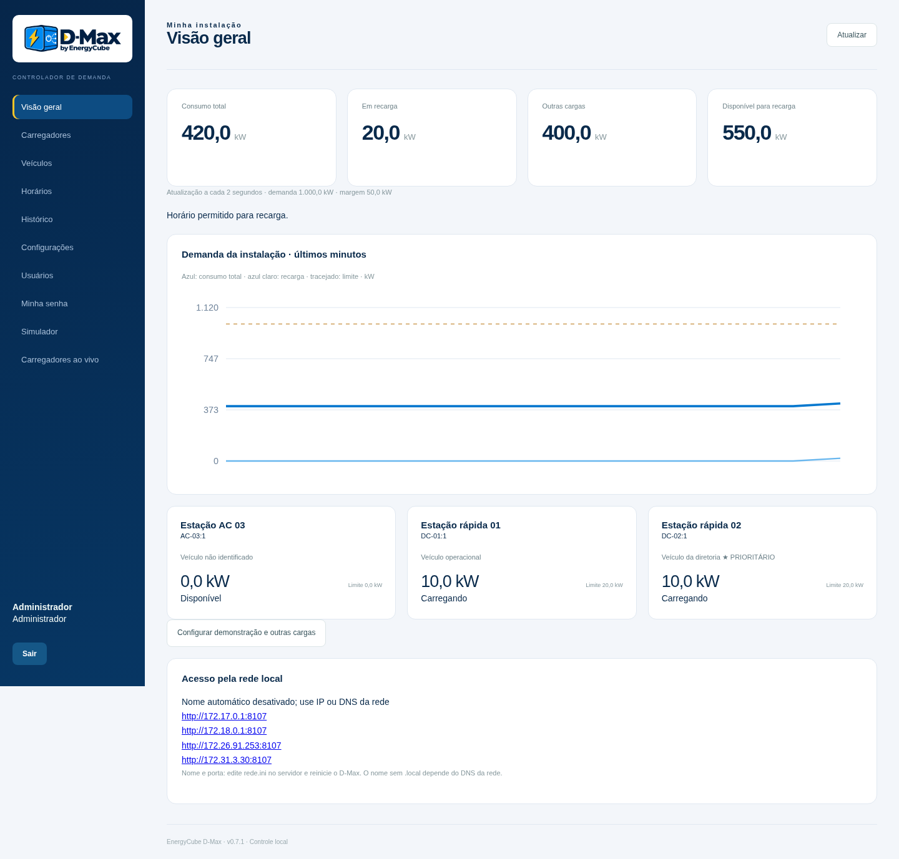

# EnergyCube D-Max — Controlador de demanda · v0.7.1

**Edição Windows 0.7.1:** interface gerada pelo servidor, sem JavaScript no navegador, com dependências locais para Python x64 3.12/3.13/3.14. [Guia de instalação](docs/instalar-windows-v071.md) · [Validação e arquitetura](docs/release-v071.md). A liberação pelo Defender ainda precisa ser verificada no Windows; mantenha qualquer alerta ativo. [Histórico dos bloqueios anteriores](docs/defender-investigation.md).

Protótipo para **validação em Windows**, com a mesma base Python no Linux ARM64 do Raspberry Pi 4. Interface web local, simulador, SQLite, distribuição de potência e adaptador OCPP 1.6J. Não depende dos dashboards antigos deste repositório.

[Tela TCP/IP](docs/multimedidor-tcp.png) · [Tela RS485](docs/multimedidor-rs485.png) · [Revisão de segurança v0.3.1](docs/security-review-v031.md)

A versão 0.7.1 mantém o controlador OCPP/Modbus e a base de dados revisados e troca a interface por páginas e formulários gerados pelo Python. O ZIP de instalação contém somente arquivos de execução, guia e dependências aprovadas pelo lock. A causa da classificação dos pacotes anteriores permanece não determinada. Esta revisão não é uma certificação antivírus.



[Nova página de usuários](docs/usuarios.png) · [Técnicos e Google](docs/tecnicos-google.png) · [Validação v0.3](docs/validation-v03.md)

## Iniciar no Windows

1. Use **Python 3.12, 3.13 ou 3.14 de 64 bits**, com o Python Launcher (`py`). Se uma dessas versões puder ser executada pela sua conta, não instale outra. Uma versão listada pode estar inacessível por permissão. Confira com `py -0p`. O iniciador testa a execução de 3.13, 3.12 e 3.14 nessa ordem, usando a primeira acessível.
2. Extraia a pasta do projeto em um diretório gravável, por exemplo `C:\D-Max`. Não execute dentro do ZIP.
3. Execute **`iniciar-windows.bat`**. No ZIP Windows 0.7.1, as dependências estão em `wheels/` e a instalação usa `--no-index --require-hashes`, sem internet. No checkout de desenvolvimento sem essa pasta, o lançador usa o PyPI. Não precisa de privilégios administrativos do Windows.
4. No próprio computador servidor, abra **http://127.0.0.1:8080**. Defina somente a senha do administrador. Para entrar como `root`, use a palavra-passe combinada com o proprietário. O pacote já contém somente seu hash e funciona offline, sem preparação por cliente. Veja o [guia de acesso raiz](docs/acesso-raiz.md). Novas contas operacionais/técnicas usam a senha inicial 12345678, com troca obrigatória, sem código de primeiro acesso.
5. Entre com o usuário `admin`, abra **Simulador** e clique em **Carregar demonstração**. Volte a **Visão geral** para acompanhar a distribuição. **Carregadores ao vivo** mostra todos os conectores com atualização a cada dois segundos.

O terminal deve permanecer aberto. `Ctrl+C` encerra o programa. Não é um instalador de serviço do Windows nesta entrega.

Início manual pelo PowerShell:

```powershell
py -3.14 -m venv .venv
.\.venv\Scripts\python.exe -m pip install --require-hashes -r requirements.lock
.\.venv\Scripts\python.exe run.py
```

## Acesso de outros computadores

O servidor usa rede.ini para nome e porta. Com nome = dmax-garagem e porta = 9090, o endereço é **http://dmax-garagem.local:9090** em redes/clientes que permitam mDNS. O nome automático é dmax-<id>.local. O painel e o terminal também mostram os IPs.

Faça a primeira configuração no próprio servidor em 127.0.0.1:porta. Depois, os demais computadores usam somente navegador e suas contas; não é preciso instalar outro controlador. Para nome sem .local, configure o DNS da rede. Mudanças de porta/nome exigem reinício e não apagam o banco. Veja o [guia de rede](docs/instalar-windows-v071.md).

## Raspberry Pi 4 e início automático

A versão inclui instalador de serviço systemd: inicia no boot e reinicia o processo após falha. Consulte o [passo a passo do Raspberry Pi](docs/raspberry.md). O serviço usa código em `/opt/d-max`, banco em `/var/lib/d-max` e configuração em `/etc/d-max`. O instalador deve ser executado no equipamento; sua inclusão no ZIP não ativa serviço algum no Windows ou neste ambiente.

## Iniciar no Linux

```bash
python3 -m venv .venv
.venv/bin/python -m pip install -r requirements.lock
.venv/bin/python run.py
```

A execução foi verificada em Linux x86-64 com Python 3.12, 3.13 e 3.14. A validação histórica incluiu Python 3.13; a revisão atual tem 126 testes em Python 3.12 e 3.14. Também foi verificada a disponibilidade de wheels das dependências fixadas para CPython 3.13 e 3.14/Windows x64. **Windows e Raspberry Pi físicos ainda precisam de validação.** As dependências com extensão nativa são instaladas para a plataforma de destino. Copie o projeto e migre o banco com backup consistente; não copie a pasta `.venv` entre sistemas.

## Identidade EnergyCube

O produto se chama **D-Max**. O painel aplica azul elétrico, azul-marinho e amarelo, com um PNG adaptado da referência de logo recebida. A imagem preparada para a interface não substitui o arquivo vetorial oficial da marca.

## Fluxo de validação

- A demonstração cria uma instalação de 1.000 kW, margem de 50 kW, dois carregadores de 320 kW e um de 22 kW. Os valores são exemplos editáveis; não existe teto de potência de 100 ou 1.000 kW.
- Altere **Outras cargas** para observar as reduções. O veículo prioritário recebe orçamento primeiro; o restante é dividido entre os demais.
- Cadastre até 60 carregadores, com limites totais e por conector, mínimos e circuitos. Conectores do mesmo equipamento compartilham seu máximo total.
- Na página **Programação**, configure dias e faixas de bloqueio, inclusive atravessando a meia-noite. As novas conexões aguardam sem iniciar. Sessões existentes vão a zero ou ao mínimo, conforme a política.
- Use **Emergência** para liberar uma sessão por prazo e motivo. A exceção não supera limites elétricos e termina na desconexão.
- Use **Pausar** e **Retomar** para controle individual. Todas as retomadas respeitam o orçamento.
- **Testar limite** faz uma redução temporária assistida, registra amostras e restaura gradualmente o orçamento ao terminar. Resultados aparecem nos eventos e na API de histórico. Não atribui automaticamente um mínimo ao carregador a partir de uma sessão; a confirmação é manual, pois o veículo influencia a observação.

## Regra de admissão

1. Calcular o orçamento, descontando as outras cargas e a margem.
2. Distribuir por prioridade, mínimo, circuito e potência compartilhada.
3. Enviar todas as reduções necessárias.
4. Aguardar medições atuais posteriores aos comandos e uma leitura atualizada da entrada.
5. Reservar a capacidade e só então enviar o início ou aumento, com rampa.

Uma resposta OCPP `Accepted` não substitui a confirmação física. Leituras antigas não confirmam reduções. Falhas de medição bloqueiam novas admissões e provocam tentativa de redução dos limites.

Nesta primeira versão, a fila usa prioridade e ordem de chegada para admitir mínimos; **rodízio e limite máximo de espera ainda não estão implementados**. Entre prioridades iguais, a potência adicional é dividida de forma igualitária, respeitando os tetos. Veículo não identificado tem prioridade normal, até associação manual.

## OCPP e piloto físico

O adaptador implementa **OCPP 1.6J**, incluindo BootNotification, Heartbeat, StatusNotification, Authorize, StartTransaction, StopTransaction, MeterValues, SetChargingProfile e RemoteStartTransaction. **OCPP 2.0.1/2.1 não está implementado.** Extensões DataTransfer são sinalizadas como não homologadas.

- Cadastre primeiro o equipamento e sua senha OCPP. Ele conecta ao controlador usando `/ocpp/IDENTIFICADOR`, subprotocolo `ocpp1.6` e HTTP Basic: usuário igual ao identificador e senha cadastrada.
- Habilite a operação física somente depois de configurar o medidor. A primeira configuração de credenciais é permitida apenas no próprio servidor.
- Esta versão exige zero e retomada homologados para autorizar um carregador físico. A marcação de comissionamento é uma declaração do instalador; o software não certifica o hardware.
- Configure o equipamento para aguardar autorização do servidor. Auto-início local/autorização em cache não pode contornar a fila. A autorização recebida do equipamento é negada até existir uma reserva de potência para o início remoto. Modelos que não tolerem esse fluxo precisam de adaptação e não devem ser habilitados.
- Perfis de uma transação ativa usam **TxProfile com transactionId**. Antes do início usa-se TxDefaultProfile; o início remoto leva seu próprio TxProfile.
- Na reconexão, uma sessão existente é mantida em espera para conciliação. Uma leitura atual com transactionId permite recuperar o vínculo; a retomada exige ação do operador. Sessões locais interrompidas por reinício são registradas como interrompidas, sem inventar energia do período ausente.
- A identificação do veículo depende do fabricante. Um idTag pode representar credencial, não veículo. A associação é explícita. Em equipamentos com vários conectores, um Authorize sem conector só é associado se houver um único candidato inequívoco.
- Potência de saída DC difere da entrada AC. O campo **Reserva de entrada / saída** reserva capacidade adicional para perdas (por exemplo 1,08); o valor precisa ser definido a partir das especificações do equipamento. A estimativa das demais cargas subtrai apenas a potência de saída observada, adotando uma estimativa conservadora de carga externa. A confirmação final é sempre pela entrada.

Por padrão, o servidor escuta somente em loopback. Para um piloto em rede, configure firewall e certificado confiável:

```powershell
.\.venv\Scripts\python.exe run.py --host 0.0.0.0 --port 8443 --tls-cert certificado.pem --tls-key chave.pem
```

Configure o carregador para `wss://IP-OU-NOME:8443/ocpp/IDENTIFICADOR`. Não exponha o serviço diretamente à internet. Use um único processo do controlador; múltiplos workers comandariam os mesmos equipamentos de forma independente.

**Antes de operação real:** faltam homologação por modelo/firmware, validação de perdas e mínimos, limites por corrente de fase, proteção elétrica independente e ensaios de perda de comunicação/energia. O controlador não evita instantaneamente um degrau de carga do cliente: medição e atuação têm latência. Configure também contingência no firmware dos carregadores quando o controlador desaparecer. Este software é um protótipo para validação, não uma proteção elétrica certificada.

## Multimedidor — TCP/IP ou RS485 Modbus

A página **Multimedidor** configura manualmente o equipamento e seu mapa. Não há endereço ou perfil de fabricante presumido. As configurações antigas da v0.1 são migradas preservando IP, Unit ID, offset, tipo, escala e ordem de palavras da potência total.

- **TCP/IP:** IP ou hostname, porta (padrão 502), Unit ID, timeout e intervalo.
- **RS485/RTU:** porta serial (`COM3` no Windows ou `/dev/ttyUSB0` no Raspberry), baud rate, paridade N/E/O, 8 bits de dados e 1/2 stop bits. Use adaptador USB–RS485 com direção automática. Configure acesso à porta serial no Linux e confira A/B, polarização, terminação e isolamento conforme o fabricante. É uma conexão de leitura; não há comandos de escrita no medidor.
- **Mapa por grandeza:** habilitação, offset, função 03/04, tipo int/uint de 16/32/64 bits ou float32/64, multiplicador e ordens de palavras e bytes independentes.
- **Grandezas:** potência ativa total, energia ativa importada, correntes L1/L2/L3, tensões L1–N/L2–N/L3–N, frequência, fator de potência e potências por fase.
- **Base:** escolha offsets base 0 ou base 1. Base 1 subtrai exatamente 1 no quadro Modbus. Referências de manual como 30001/40001 não são convertidas automaticamente; conferir o offset e a função do fabricante.
- **Escala:** converte para a unidade final da tela. Por exemplo: W para kW → `0,001`; décimos de ampère para A → `0,1`. Escala zero é inválida; uma escala negativa pode corrigir a convenção da potência, se documentada.
- **Testar leitura:** usa o formulário sem salvar, exibe valores, unidades, endereços e erros. O botão não altera o controle em operação. Salve para aplicar; a troca do mapa invalida a leitura anterior até uma nova amostra válida.

A potência ativa total é obrigatória em operação física. O medidor deve incluir toda a entrada, incluindo os carregadores. Ausência ou erro nessa leitura impede novas liberações. Falha em uma grandeza auxiliar é mostrada no diagnóstico sem fabricar um valor.

A energia da instalação passa a ser consolidada quando seu registrador estiver habilitado e válido. Sem esse dado, o campo de energia da amostra é `null`, não uma medição de zero. Resets do acumulador são sinalizados. A leitura das correntes por fase está disponível para visualização; a política de proteção por corrente de fase continua pendente.

O transporte RTU foi validado com frames/CRC e com o driver pyserial sobre uma pseudoporta Linux. Isso não substitui homologação do adaptador e multimedidor reais.

## Banco local, nuvem e retenção

- SQLite em `data/controller.sqlite3`, com WAL e sincronização FULL. Para outro caminho, defina `EV_DB_PATH`.
- Eventos operacionais são gravados imediatamente. As leituras são consolidadas por minuto com média, mínimo, máximo, número de amostras e energia. A energia da sessão usa os registros acumulados; resets são sinalizados e não subtraem energia.
- A interface recebe o estado local por WebSocket a cada segundo. A atualização física continua limitada pela frequência dos equipamentos.
- Eventos e amostras entram em uma fila durável. Uma vez por minuto o controlador tenta enviar um lote de até 200 registros.
- Configure a URL HTTPS da API central e a variável de ambiente **`EV_CLOUD_TOKEN`**. O identificador do controlador é gerado e persistido na instalação; `EV_CONTROLLER_ID` permite definir uma identificação externa.
- O banco central e o Grafana **ainda não foram provisionados ou testados contra um serviço remoto**. O contrato de integração está em [docs/cloud-api.md](docs/cloud-api.md).
- Leituras já confirmadas: retenção local configurável de 1 a 30 dias, padrão 7. Eventos confirmados: 30 dias. Sessões resumidas, cadastros, aprendizado e configurações permanecem. Os kWh por sessão são preservados.
- Dados não confirmados nunca são apagados pela limpeza. Não há exclusão em massa no dia 5: a primeira versão usa limpeza por retenção. Fechamento mensal automático, resumos materializados diários/mensais e alarmes de capacidade de disco ainda estão pendentes.
- O banco ainda não foi submetido a um ensaio de 30 dias com 60 equipamentos. Dimensionar o SSD antes da implantação e verificar o volume real. Não há promessa de capacidade ilimitada se a internet faltar indefinidamente.

Faça backup com o serviço parado ou usando a API de backup do SQLite; copiar apenas o arquivo principal enquanto WAL estiver ativo pode perder dados recentes. Os eventos do último minuto são persistidos, mas o agregador de leituras em andamento está em memória: uma queda abrupta pode perder o resumo parcial desse minuto. A energia já recebida fica nos registros de sessão.

## Google Planilhas e técnicos globais

A opção principal usa somente Google Planilhas + Apps Script, hospedado pelo Google, sem VPS. A página **Técnicos globais** (raiz) configura a URL publicada, chave do equipamento e intervalo de consulta. Offline, vale exatamente a validade recebida da planilha, sem prazo extra. Consulte o [passo a passo de ativação no Google](docs/google-planilhas.md). A integração só estará ativa após publicar o script e configurar a URL e chave; o link de edição da planilha não é a API.

## Acesso e recuperação

Perfis iniciais: `admin` e `root`. A senha de admin é definida pelo instalador; root aceita a palavra-passe do proprietário, cujo verificador PBKDF2 já vem em app/root-credential.json. Não existe preparação por cliente nem necessidade de chaves para o login normal. A sessão raiz vale 15 minutos. Uma assinatura Ed25519 continua sendo alternativa opcional se a pública for provisionada. As senhas de login comuns são armazenadas com PBKDF2-SHA256, salt individual e 600.000 iterações. A conta root recupera a senha de admin e revoga as sessões anteriores. Esse acesso pertence à aplicação, separado do usuário root do Linux. O login tem limitação de tentativas, cookie HttpOnly e SameSite, validação de origem e auditoria.

A versão inclui cadastro de operadores, administradores e técnicos conforme a hierarquia, bloqueio/exclusão com auditoria, alteração de senha e recuperação do administrador. As senhas existentes, exceto root que recebe o verificador do pacote, são preservadas na migração; uma cópia SQLite é criada antes de migrar um banco antigo com usuários. A palavra-passe raiz é compartilhada entre os equipamentos deste pacote: mantenha seu sigilo. O hash não elimina risco de adivinhação offline ou de uma credencial já exposta. A recuperação assinada permanece opcional; veja o [guia](docs/acesso-raiz.md).

## Testes

Revisão 0.7.1: **126 testes aprovados em Python 3.12 e 3.14, em Linux**, mais fluxo completo do pacote de execução no Chromium com JavaScript desativado, em desktop/celular. Inclui recuperação Ed25519, expiração, uso único, vínculo ao navegador/equipamento, rotação de chave, CSRF vinculado à sessão, restrição da primeira instalação, permissões, primeiro acesso sem código, medidor, horários e autenticação concorrente. A resolução offline das wheels foi conferida para Windows x64 nas três versões suportadas. Não equivale à homologação nativa no Windows/Raspberry nem a uma varredura do Microsoft Defender.

```powershell
.\.venv\Scripts\python.exe -m unittest discover -s tests -v
```

```bash
.venv/bin/python -m unittest discover -s tests -v
```

Os testes usam credenciais fictícias e banco em memória. Não acessam carregadores ou medidores de produção. Há cenários de registradores manuais TCP/RTU, CRC, escalas, migração de configuração, 60 carregadores, orçamento de 15 MW, prioridades, mínimos, compartilhamento, horários, autenticação, recuperação, retenção e troca de mensagens OCPP.

Os arquivos de `app/static/` são locais: não há fontes, bibliotecas ou scripts externos necessários ao painel. Capturas de desktop e celular estão em `docs/`.

## Falha 1603 ao instalar Python

O iniciador desta versão aproveita Python 3.12, 3.13 ou 3.14 já instalado e acessível. Para o diagnóstico da falha MSI observada e instruções de uso sem reinstalação, consulte [Python no Windows](docs/python-windows.md).

## Atualização de uma instalação existente

Encerre o D-Max antes de copiar dados. Faça backup consistente do banco antigo e preserve suas credenciais. No Windows, a pasta `data/` deve acompanhar a nova pasta do programa para manter os cadastros; não copie `.venv` entre versões de Python ou sistemas. No Raspberry, o banco permanece em `/var/lib/d-max`, separado do código. A primeira migração de usuários gera um arquivo privado `*.before-users-v03-*.sqlite3`; para voltar a uma versão antiga, restaure código e banco correspondentes. A cópia de migração não substitui uma política de backup.

Na atualização para 0.7.1, o hash raiz do pacote é aplicado automaticamente e sessões root são revogadas se a credencial mudar. Reiniciar com o mesmo hash mantém as sessões válidas. Senhas dos demais usuários e dados operacionais são preservados. Copie somente data/ e rede.ini da versão anterior; não copie app/ ou .venv. Não é preciso gerar chaves ou configurar root na instalação. Para login, use root e a palavra-passe combinada com o proprietário; veja docs/acesso-raiz.md.
