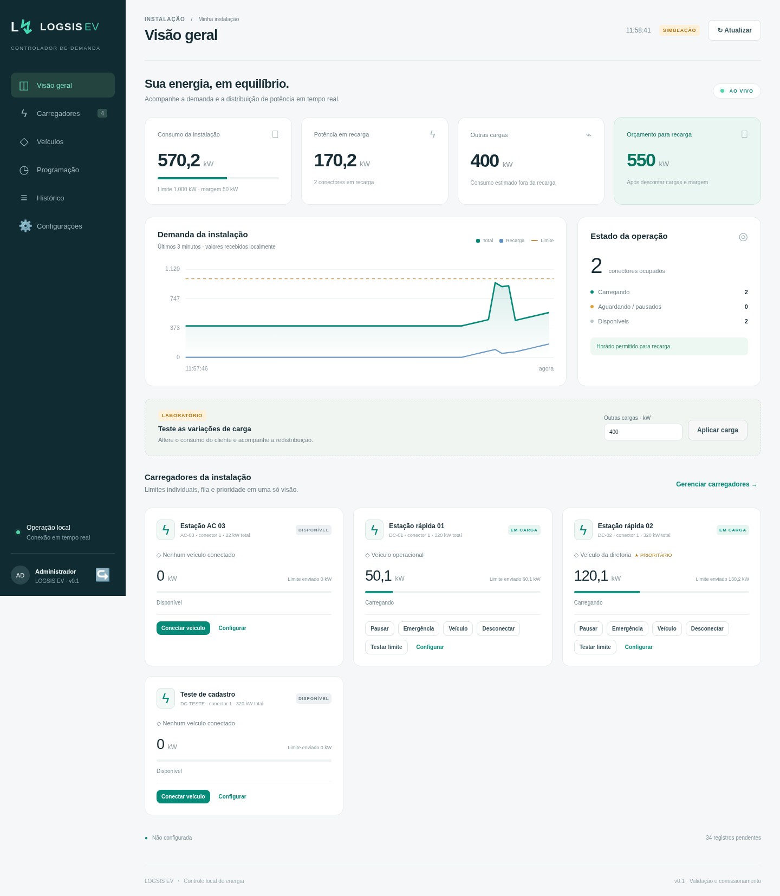

# LOGSIS EV — Controlador de demanda · v0.1

Primeira versão para **validação em Windows**, com a mesma base Python no Linux ARM64 do Raspberry Pi 4. Interface web local, simulador, SQLite, distribuição de potência e adaptador OCPP 1.6J. Não depende dos dashboards antigos deste repositório.



## Iniciar no Windows

1. Instale **Python 3.12 de 64 bits**, com o Python Launcher (`py`).
2. Extraia a pasta do projeto em um diretório gravável, por exemplo `C:\LOGSIS-EV`. Não execute dentro do ZIP.
3. Execute **`iniciar-windows.bat`**. A primeira execução precisa de internet para instalar as dependências. Depois de instaladas, o mesmo lançador funciona sem internet enquanto o arquivo de dependências não mudar.
4. No próprio computador servidor, abra **http://127.0.0.1:8080**. Defina a senha raiz e uma senha separada para o administrador. Nenhuma senha é embutida no código ou no pacote.
5. Entre com o usuário `admin` e clique em **Carregar demonstração**.

O terminal deve permanecer aberto. `Ctrl+C` encerra o programa. Não é um instalador de serviço do Windows nesta entrega.

Início manual pelo PowerShell:

```powershell
py -3.12 -m venv .venv
.\.venv\Scripts\python.exe -m pip install -r requirements.lock
.\.venv\Scripts\python.exe run.py
```

## Iniciar no Linux

```bash
python3 -m venv .venv
.venv/bin/python -m pip install -r requirements.lock
.venv/bin/python run.py
```

A execução foi verificada em Linux x86-64 com Python 3.12. **Windows e Raspberry Pi físicos ainda precisam de validação.** As dependências com extensão nativa são instaladas para a plataforma de destino. Copie o projeto e migre o banco com backup consistente; não copie a pasta `.venv` entre sistemas.

## Fluxo de validação

- A demonstração cria uma instalação de 1.000 kW, margem de 50 kW, dois carregadores de 320 kW e um de 22 kW. Os valores são exemplos editáveis; não existe teto de potência de 100 ou 1.000 kW.
- Altere **Outras cargas** para observar as reduções. O veículo prioritário recebe orçamento primeiro; o restante é dividido entre os demais.
- Cadastre até 60 carregadores, com limites totais e por conector, mínimos e circuitos. Conectores do mesmo equipamento compartilham seu máximo total.
- Na página **Programação**, configure dias e faixas de bloqueio, inclusive atravessando a meia-noite. As novas conexões aguardam sem iniciar. Sessões existentes vão a zero ou ao mínimo, conforme a política.
- Use **Emergência** para liberar uma sessão por prazo e motivo. A exceção não supera limites elétricos e termina na desconexão.
- Use **Pausar** e **Retomar** para controle individual. Todas as retomadas respeitam o orçamento.
- **Testar limite** faz uma redução temporária assistida, registra amostras e restaura gradualmente o orçamento ao terminar. Resultados aparecem nos eventos e na API de histórico. Não atribui automaticamente um mínimo ao carregador a partir de uma sessão; a confirmação é manual, pois o veículo influencia a observação.

## Regra de admissão

1. Calcular o orçamento, descontando as outras cargas e a margem.
2. Distribuir por prioridade, mínimo, circuito e potência compartilhada.
3. Enviar todas as reduções necessárias.
4. Aguardar medições atuais posteriores aos comandos e uma leitura atualizada da entrada.
5. Reservar a capacidade e só então enviar o início ou aumento, com rampa.

Uma resposta OCPP `Accepted` não substitui a confirmação física. Leituras antigas não confirmam reduções. Falhas de medição bloqueiam novas admissões e provocam tentativa de redução dos limites.

Nesta primeira versão, a fila usa prioridade e ordem de chegada para admitir mínimos; **rodízio e limite máximo de espera ainda não estão implementados**. Entre prioridades iguais, a potência adicional é dividida de forma igualitária, respeitando os tetos. Veículo não identificado tem prioridade normal, até associação manual.

## OCPP e piloto físico

O adaptador implementa **OCPP 1.6J**, incluindo BootNotification, Heartbeat, StatusNotification, Authorize, StartTransaction, StopTransaction, MeterValues, SetChargingProfile e RemoteStartTransaction. **OCPP 2.0.1/2.1 não está implementado.** Extensões DataTransfer são sinalizadas como não homologadas.

- Cadastre primeiro o equipamento e sua senha OCPP. Ele conecta ao controlador usando `/ocpp/IDENTIFICADOR`, subprotocolo `ocpp1.6` e HTTP Basic: usuário igual ao identificador e senha cadastrada.
- Habilite a operação física somente depois de configurar o medidor. A primeira configuração de credenciais é permitida apenas no próprio servidor.
- Esta versão exige zero e retomada homologados para autorizar um carregador físico. A marcação de comissionamento é uma declaração do instalador; o software não certifica o hardware.
- Configure o equipamento para aguardar autorização do servidor. Auto-início local/autorização em cache não pode contornar a fila. A autorização recebida do equipamento é negada até existir uma reserva de potência para o início remoto. Modelos que não tolerem esse fluxo precisam de adaptação e não devem ser habilitados.
- Perfis de uma transação ativa usam **TxProfile com transactionId**. Antes do início usa-se TxDefaultProfile; o início remoto leva seu próprio TxProfile.
- Na reconexão, uma sessão existente é mantida em espera para conciliação. Uma leitura atual com transactionId permite recuperar o vínculo; a retomada exige ação do operador. Sessões locais interrompidas por reinício são registradas como interrompidas, sem inventar energia do período ausente.
- A identificação do veículo depende do fabricante. Um idTag pode representar credencial, não veículo. A associação é explícita. Em equipamentos com vários conectores, um Authorize sem conector só é associado se houver um único candidato inequívoco.
- Potência de saída DC difere da entrada AC. O campo **Reserva de entrada / saída** reserva capacidade adicional para perdas (por exemplo 1,08); o valor precisa ser definido a partir das especificações do equipamento. A estimativa das demais cargas subtrai apenas a potência de saída observada, adotando uma estimativa conservadora de carga externa. A confirmação final é sempre pela entrada.

Por padrão, o servidor escuta somente em loopback. Para um piloto em rede, configure firewall e certificado confiável:

```powershell
.\.venv\Scripts\python.exe run.py --host 0.0.0.0 --port 8443 --tls-cert certificado.pem --tls-key chave.pem
```

Configure o carregador para `wss://IP-OU-NOME:8443/ocpp/IDENTIFICADOR`. Não exponha o serviço diretamente à internet. Use um único processo do controlador; múltiplos workers comandariam os mesmos equipamentos de forma independente.

**Antes de operação real:** faltam homologação por modelo/firmware, validação de perdas e mínimos, limites por corrente de fase, proteção elétrica independente e ensaios de perda de comunicação/energia. O controlador não evita instantaneamente um degrau de carga do cliente: medição e atuação têm latência. Configure também contingência no firmware dos carregadores quando o controlador desaparecer. Este software é um protótipo para validação, não uma proteção elétrica certificada.

## Smart meter

Implementada leitura **Modbus TCP, função 03 (holding registers)**: inteiro de 16/32 bits ou float32, ordem de palavras configurável e multiplicador para converter em kW. Cadastre o registrador da **potência ativa total importada**, medindo toda a entrada, incluindo carregadores. Conferir endereço baseado em zero, unidade, ordem e escala no manual do medidor. Não há mapa universal. Modbus RTU, função 04 e leitura de correntes por fase ficam para uma próxima etapa.

## Banco local, nuvem e retenção

- SQLite em `data/controller.sqlite3`, com WAL e sincronização FULL. Para outro caminho, defina `EV_DB_PATH`.
- Eventos operacionais são gravados imediatamente. As leituras são consolidadas por minuto com média, mínimo, máximo, número de amostras e energia. A energia da sessão usa os registros acumulados; resets são sinalizados e não subtraem energia.
- A interface recebe o estado local por WebSocket a cada segundo. A atualização física continua limitada pela frequência dos equipamentos.
- Eventos e amostras entram em uma fila durável. Uma vez por minuto o controlador tenta enviar um lote de até 200 registros.
- Configure a URL HTTPS da API central e a variável de ambiente **`EV_CLOUD_TOKEN`**. O identificador do controlador é gerado e persistido na instalação; `EV_CONTROLLER_ID` permite definir uma identificação externa.
- O banco central e o Grafana **ainda não foram provisionados ou testados contra um serviço remoto**. O contrato de integração está em [docs/cloud-api.md](docs/cloud-api.md).
- Leituras já confirmadas: retenção local configurável de 1 a 30 dias, padrão 7. Eventos confirmados: 30 dias. Sessões resumidas, cadastros, aprendizado e configurações permanecem. Os kWh por sessão são preservados.
- Dados não confirmados nunca são apagados pela limpeza. Não há exclusão em massa no dia 5: a primeira versão usa limpeza por retenção. Fechamento mensal automático, resumos materializados diários/mensais e alarmes de capacidade de disco ainda estão pendentes.
- O banco ainda não foi submetido a um ensaio de 30 dias com 60 equipamentos. Dimensionar o SSD antes da implantação e verificar o volume real. Não há promessa de capacidade ilimitada se a internet faltar indefinidamente.

Faça backup com o serviço parado ou usando a API de backup do SQLite; copiar apenas o arquivo principal enquanto WAL estiver ativo pode perder dados recentes. Os eventos do último minuto são persistidos, mas o agregador de leituras em andamento está em memória: uma queda abrupta pode perder o resumo parcial desse minuto. A energia já recebida fica nos registros de sessão.

## Acesso e recuperação

Perfis iniciais: `admin` e `root`. As senhas são definidas pelo instalador e armazenadas com PBKDF2-SHA256, salt individual e 600.000 iterações. A conta root recupera a senha de admin e revoga as sessões anteriores. Esse acesso pertence à aplicação, separado do usuário root do Linux. O login tem limitação de tentativas, cookie HttpOnly e SameSite, validação de origem e auditoria.

Criação de operadores adicionais, recuperação por console e rotação da própria senha root serão incluídas em uma evolução. Guarde as credenciais com cuidado nesta versão.

## Testes

```powershell
.\.venv\Scripts\python.exe -m unittest discover -s tests -v
```

```bash
.venv/bin/python -m unittest discover -s tests -v
```

Os testes usam credenciais fictícias e banco em memória. Não acessam carregadores ou medidores de produção. Há cenários de 60 carregadores, orçamento de 15 MW, prioridades, mínimos, compartilhamento, horários, autenticação, recuperação, retenção e troca de mensagens OCPP.

Os arquivos de `app/static/` são locais: não há fontes, bibliotecas ou scripts externos necessários ao painel. Capturas de desktop e celular estão em `docs/`.
