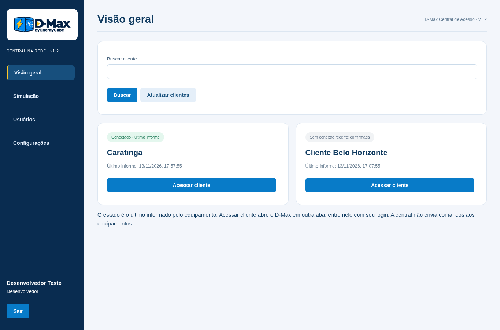

# D-Max Central de Acesso 1.2.0 — Windows na rede

O Windows hospeda a página com o logo original do D-Max. Uma instalação atende os navegadores dos demais computadores da mesma rede. O endereço padrão é **http://d-max.local:80**; desenvolvedores podem alterar nome e porta em Configurações, confirmando a senha. A janela local permite a configuração inicial pelo proprietário da conta Windows.



## Instalar

1. Instale `releases/D-Max-Central-Rede-1.2.0-Completo.msi` em um computador Windows 10/11 x64.
2. Abra **D-Max Central de Acesso** pelo atalho. O MSI só instala.
3. Informe a URL `/exec` da plataforma existente, mantenha nome `d-max` e porta `80`, salve e abra a página.
4. Se o Windows pedir permissão de rede, permita o aplicativo em **redes privadas**. Não é necessário desativar proteções. São usados TCP da porta escolhida e mDNS UDP 5353.
5. Nos outros computadores, abra **http://d-max.local:80** e entre com o login e senha individuais da planilha. Não há instalação nesses computadores.

O servidor inclui o runtime Microsoft necessário. A versão Desktop anterior é atualizada no mesmo usuário Windows. A URL pública antiga pode ser importada para o formulário inicial. O computador servidor deve ficar ligado e com o usuário conectado. Fechar a janela mantém o aplicativo na bandeja; **Encerrar servidor** interrompe o acesso. Não há serviço ou inicialização automática com o Windows; depois de reiniciar, abra o atalho.

Se `.local` não resolver, tente o IP mostrado na janela. Confirme que os computadores podem comunicar-se na rede, que multicast não está isolado e que a porta não está ocupada por outro programa. Quando o nome já estiver em uso, o anúncio informa conflito; altere o nome de um dos equipamentos. O aplicativo não altera o nome Windows. Alterações pela página reiniciam o servidor e descartam as sessões. Se a nova configuração falhar ao iniciar, o programa tenta restaurar a anterior.

## Plataforma e permissões

Usa as operações `desktop_login`, `desktop_state`, `desktop_logout`, `desktop_clients`, `desktop_members` e `desktop_save_user` existentes em `google-apps-script/Code.gs`. Se essa versão da plataforma já está implantada, não é necessário atualizar o Apps Script. Nenhuma implantação Google ou Raspberry é alterada pelo instalador. Implantações antigas sem essas operações precisam ser atualizadas explicitamente, preservando URL, propriedades e planilha.

Desenvolvedores têm acesso a clientes, simulação, membros/verificadores e configuração do servidor. Comercial/técnico têm clientes e simulação, com validação online de conta/situação/validade. Criação e alterações de usuários continuam autorizadas no Google com a senha atual do desenvolvedor. Os clientes são apresentados pelo nome e botão de acesso, sem URL como texto. Conexão é o último estado informado, não um teste instantâneo de disponibilidade.

A demonstração é independente por navegador, mostra SOC, termina em 100% e não chama comandos de carregadores ou controlador. Encerrar a sessão descarta a demonstração. O comercial encerra após 15 minutos sem interação. O acesso ao equipamento abre outra aba, sujeito ao login e às permissões do próprio equipamento.

## Dados e rede

O servidor escuta IPv4 local na porta configurada, aceita somente origens de rede privada/loopback e verifica o cabeçalho Host. Usa cookies HttpOnly/SameSite, verificação antiforgery em POST, CSP e limites de requisições/conexões. Os tokens Google ficam somente na memória do servidor, sem armazenamento no navegador. A conexão à plataforma é HTTPS. O endereço pedido é HTTP na rede local: use rede privada confiável, pois o trecho entre navegador e servidor não é cifrado.

Configuração em `%LOCALAPPDATA%\EnergyCube\DMaxAcessoLan\server.json` (nome, porta, URL pública). Chaves antiforgery em `Keys`, protegidas por DPAPI no Windows. O MSI não cria regras automáticas de firewall, serviços, tarefas, ações executáveis customizadas ou mudanças globais do .NET. Binários próprios sem assinatura Authenticode; nenhum teste em Windows real/Defender foi realizado neste ambiente Linux.

## Construção e validação

SDK Microsoft 10.0.404; runtimes oficiais Core/WindowsDesktop/ASP.NET 10.0.15 com hashes registrados em `desktop/runtime-packages.json`. Publique com SDK para Windows x64:

```sh
dotnet publish desktop/DMaxAcesso.csproj -c Release -p:RestoreLockedMode=true -o /tmp/dmax-lan-publish
```

Copie as licenças dos quatro pacotes Microsoft para `Licencas` no diretório publicado e use `tools/package_desktop.py` com `wixl`, `msiinfo`, `--published-dir` e `--output`. A ferramenta exige publicação autocontida com os três runtimes e todos os assets, inclui o LEIA-ME e audita tabelas do MSI, atalhos, escopo e manifesto SHA256 de cada arquivo. O relatório `.audit.json` distingue testes realizados de execução Windows/Defender não realizada.

Validação automatizada:

```sh
dotnet run --project lan/tests/DMaxLan.Tests.csproj -c Release
python -m unittest tests.test_desktop_runtime_package -v
# Em outro terminal, inicia somente dados fictícios locais:
dotnet run --project lan/tests/DMaxLan.Tests.csproj -c Release -- --serve
node tests/browser_lan_portal.cjs
```

Os testes cobrem padrão exato do endereço, dados DNS A/SRV/PTR/TXT e retirada TTL zero, parser DNS limitado, Host/CSRF, cookies, permissões, revalidação online, configuração com senha/reinício e persistência sem credenciais. Chromium cobre logo original, login, recarga, clientes, membros/verificador, sessões distintas, restrições comercial, simulação isolada e parada em 100%, layout móvel e rolagem. O serviço central é substituído por transporte HTTP fictício; os testes não modificam a planilha. Também foi confirmado o anúncio real IPv4/DNS-SD com o cliente independente Python Zeroconf (`dotnet run --project lan/tests/DMaxLan.Tests.csproj -c Release -- --announce`, seguido de `python tests/probe_lan_mdns.py` com `zeroconf` instalado). A resolução mDNS e liberação pelo firewall de uma rede Windows real dependem do ambiente de instalação.
